<!-- ═══════════ HEADER ═══════════ -->

  

  

  
  
  

  <b>3+ years owning products end to end — architecture, APIs, data, deployment.</b> 
  Full-stack depth in Node.js & Next.js. Now building RAG and agentic AI systems in Python.

 

<!-- ═══════════ IMPACT ═══════════ -->
<h2 align="center">⚡ Impact</h2>

<table align="center">
  <tr>
    <td align="center" width="200"><h3>90s → 300ms</h3>Search API latency</td>
    <td align="center" width="200"><h3>150 → 1</h3>N+1 queries → one aggregation</td>
    <td align="center" width="200"><h3>1 → 6</h3>Monolith → microservices on K8s</td>
  </tr>
  <tr>
    <td align="center"><h3>0</h3>Double bookings (Redis lock)</td>
    <td align="center"><h3>−95%</h3>Third-party API calls (cache)</td>
    <td align="center"><h3>−80%</h3>Socket payloads (delta signaling)</td>
  </tr>
</table>

 

<!-- ═══════════ GENAI ═══════════ -->
<h2 align="center">🤖 What I'm Building</h2>

<table align="center">
  <tr>
    <td align="center" width="300">
      <h3>🧠 OrbitDesk</h3>
      RAG + agentic helpdesk copilot Hybrid search · reranking · RBAC  
      
      
      
    </td>
    <td align="center" width="300">
      <h3>🎙️ Pluto</h3>
      Voice-controlled coding agent on Alexa Tool-calling · LLM failover · sandbox  
      
      
      
    </td>
    <td align="center" width="300">
      <h3>🏢 ERP SaaS</h3>
      Multi-tenant Django backend Self-hosted LLM on Celery queues  
      
      
    </td>
  </tr>
</table>

 

<!-- ═══════════ STACK ═══════════ -->
<h2 align="center">🛠️ Tech Stack</h2>

<table align="center">
  <tr>
    <td align="right" width="150"><b>Languages</b></td>
    <td></td>
  </tr>
  <tr>
    <td align="right" width="150"><b>Backend</b></td>
    <td></td>
  </tr>
  <tr>
    <td align="right" width="150"><b>Frontend</b></td>
    <td></td>
  </tr>
  <tr>
    <td align="right" width="150"><b>Data</b></td>
    <td></td>
  </tr>
  <tr>
    <td align="right" width="150"><b>Cloud &amp; DevOps</b></td>
    <td></td>
  </tr>
  <tr>
    <td align="right" width="150"><b>GenAI</b></td>
    <td>        </td>
  </tr>
  <tr>
    <td align="right" width="150"><b>Evals &amp; LLMOps</b></td>
    <td>    </td>
  </tr>
  <tr>
    <td align="right" width="150"><b>Architecture</b></td>
    <td>      </td>
  </tr>
</table>

 

<!-- ═══════════ HOW I BUILD ═══════════ -->
<h2 align="center">🏗️ How I Build</h2>

  

 

<!-- ═══════════ FOOTER ═══════════ -->

  

